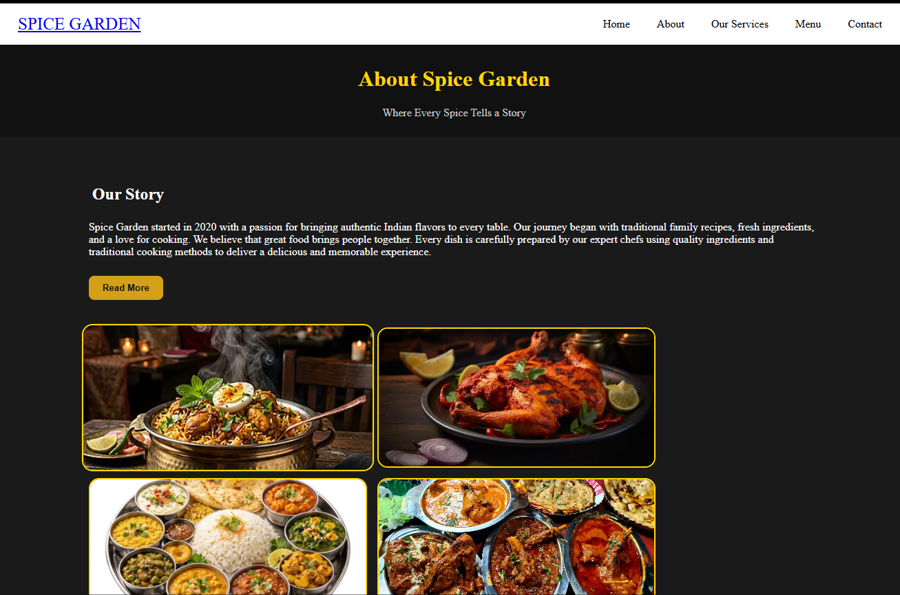
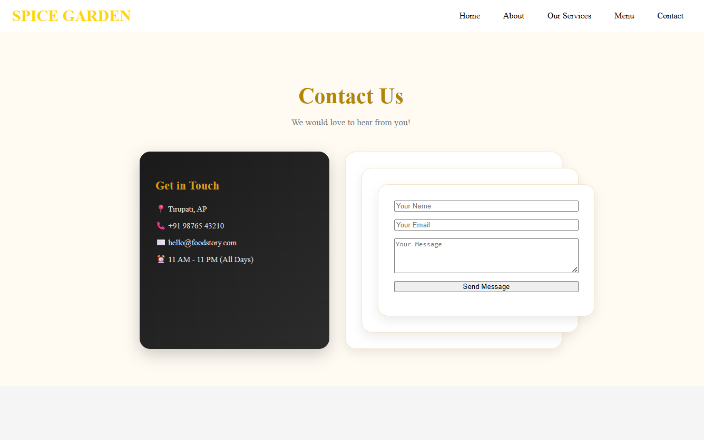

# Oasis Infobyte Internship – Task 1

## Spice Garden Restaurant Website

A responsive restaurant website developed using HTML5, CSS3, and JavaScript. The website provides information about the restaurant, its menu, services, and contact details.

## Live Website

[Visit Spice Garden Website](https://K-sravani-04.github.io/Spice-Garden-Website/HTML/home.html)

## Screenshots

### 1. Home Page

The Home Page introduces the Spice Garden restaurant with its navigation bar and attractive design.


### 2. Menu Page

The Menu Page displays different food items available at the restaurant.


### 3. About Page

The About Page provides information about the restaurant.



### 4. Our Services

The Services Page highlights the services offered by the restaurant.


### 5. Contact Page

The Contact Page provides contact information for visitors.



## Features

- Responsive website design
- Restaurant menu with food images
- Home, About, Menu, Services, and Contact pages
- Interactive buttons using JavaScript
- Restaurant contact information
- User-friendly navigation

## Technologies Used

- HTML5
- CSS3
- JavaScript

## Project Structure

```text
Spice-Garden-Website/
│
├── home.html
├── about.html
├── menu.html
├── contact.html
├── our services.html
│
├── home.css
├── about.css
├── menu.css
├── contact.css
├── our services.css
│
├── home.js
├── about.js
├── menu.js
├── contact.js
├── our services.js
│
├── home.png
├── about.png
├── menu.png
├── contact.png
└── our services.png
```

## How to Run Locally

1. Download or clone this repository.
2. Open the project folder in Visual Studio Code.
3. Open `home.html` using Live Server.
4. Navigate through the website pages.

## Internship

**Organization:** Oasis Infobyte  
**Track:** Web Development and Designing  
**Task:** Restaurant Website

## Author

K-sravani-04

